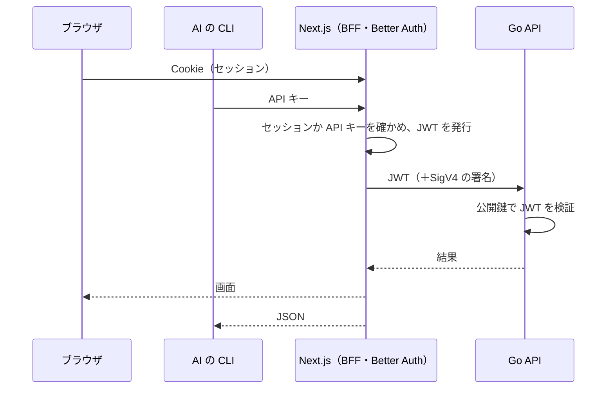

# 0004. 認証

- 状態: 承認
- 日付: 2026-10-14

## 背景

- ログインが要るのは、日記の持ち主（はんこと一言を付ける人）
- AI（CLI）は人間の代わりに提出する。対話的なログインはできないので、長く使える資格情報が要る
- 誰でもすぐにローカルで動かせる必要がある（1-B-1）。外部の IdP に頼ると、ローカル実行が難しくなる
- 認証のロジックは自前で書かず、IdP やライブラリを活用したい
- フロントは Next.js＋BFF（0003）。Go はブラウザや CLI から直接は呼ばれない

## 選択肢

### 認証の仕組み

#### A. Better Auth（Next.js で動かす）

- 良い点: GitHub ログイン、API キー、JWT の発行がプラグインで揃う。ユーザーやセッションを自分の DB に持つので、ローカルでもそのまま動く
- 悪い点: DB のテーブルを Better Auth の形に合わせる必要がある。Aurora DSQL で動くか確かめる必要がある

#### B. Auth.js

- 良い点: Next.js での利用例が多い
- 悪い点: API キーの仕組みがなく、Go に渡すトークンも自分で組む必要がある

#### C. Amazon Cognito

- 良い点: AWS のマネージドサービスで、ユーザー管理を任せられる
- 悪い点: GitHub ログインに標準で対応していない。CLI 向けの機械間の認証は有料。ローカル実行が難しい

#### D. Go で自前に組む

- 良い点: Go だけで完結する
- 悪い点: セッションや CSRF 対策など、間違えると危ない処理を自分で書くことになる

### 本番のログイン方法

#### A. GitHub だけ

- 良い点: 対象の利用者（AI と開発するエンジニア）と審査員は、ほぼ全員が GitHub のアカウントを持っている。パスワードを扱わずに済む
- 悪い点: GitHub を持たない人は使えない

#### B. メールアドレスとパスワードも使う

- 悪い点: メールアドレスの確認とパスワードの再設定が必要になり、メールを送る仕組み（Amazon SES など）を足すことになる

### Go への受け渡し

#### A. Better Auth の JWT を、Go が公開鍵（JWKS）で検証する

- 良い点: Go は DB のセッションを見なくてよい。Better Auth のテーブルの形に依存しない
- 悪い点: JWT の有効期限と、鍵の入れ替えを考える必要がある

#### B. Go が Better Auth のセッションのテーブルを直接読む

- 悪い点: Better Auth のテーブルの形に Go が縛られる

## 決定

- 仕組み: A（Better Auth）
- 本番のログイン: A（GitHub だけ）
- AI（CLI）: Better Auth の API キー（`@better-auth/api-key`）
- ローカル: メールアドレスとパスワード、最初から入っているデモユーザー。本番でこれが有効になっていたら、起動時にエラーで止める
- Go への受け渡し: A（JWT プラグイン。署名は EdDSA、公開鍵は `/api/auth/jwks` で公開する）
- 誰が登録できるかは、機能要件で決める

## 結果

### 良くなること

- ブラウザにも CLI にも、Go 用のトークンを持たせない
- ローカルでは、GitHub の設定なしでログインできる

### 悪くなること・リスク

- Better Auth が Aurora DSQL で動かなければ、DB を Neon に変える（0005）
- 本番では、GitHub に障害があるとログインできない

### 確かめること（W1）

- Better Auth のテーブルとマイグレーションが Aurora DSQL で動くか
- API キーでの呼び出しから JWT を発行できるか
