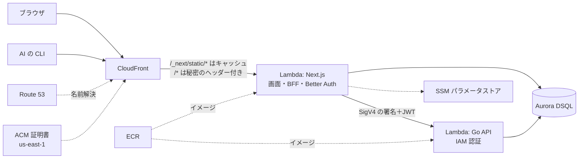

# 0005. インフラ構成

- 状態: 提案（W1 の試し打ちの結果で承認する）
- 日付: 2026-10-14

## 背景

- 独自ドメインと HTTPS で、第三者に公開する（1-B-5、2-B-6）
- マネージドサービスを組み合わせて構成する（2-B-3）
- AWS の無料プラン（2026年9月ごろ作成）を使う。6か月たつか、クレジットを使い切ると停止する。費用は月数ドルに抑えたい
- 動かすものは3つ: Next.js（画面、BFF、認証）、Go の API、PostgreSQL
- リージョンは東京にしたい

費用は2026年10月時点の東京リージョンの目安です。

## 選択肢

### アプリの実行環境

#### A. Lambda＋コンテナ（Lambda Web Adapter）

- 良い点: リクエストがないときはほぼ無料。ローカル実行と本番で同じ Dockerfile を使える
- 悪い点: コールドスタートがある。Next.js を Lambda で動かすには調整が要る

#### B. ECS Fargate＋ALB

- 良い点: 常に起動しているので、コールドスタートがない
- 悪い点: ALB だけで月 $16 以上かかる。止めない限り課金が続く

### DB

#### A. RDS for PostgreSQL＋VPC

- 良い点: 普通の PostgreSQL そのもの
- 悪い点: RDS が月約 $21。Lambda を VPC に入れると外への通信に NAT Gateway（月約 $45）か NAT インスタンス（月約 $8）が要る

#### B. Aurora DSQL

- 良い点: 公開エンドポイント＋IAM 認証なので VPC も NAT も要らない。無料枠がある。東京リージョンにある
- 悪い点: PostgreSQL と完全には互換でない（1つのトランザクションに DDL を混ぜられない、など）。Better Auth が動くか確かめる必要がある

#### C. Neon

- 良い点: PostgreSQL との互換性が高い。無料枠がある
- 悪い点: 東京リージョンがない（シンガポールになる）。AWS の外のサービスになる

### Go の API の守り方

#### A. Function URL＋IAM 認証

- 良い点: Next.js だけが SigV4 の署名付きで呼べる。外から直接は呼べない
- 悪い点: Next.js 側で署名の処理が要る

#### B. 公開して、JWT の検証だけで守る

- 良い点: 署名の処理が要らない
- 悪い点: 攻撃される入口が2つになる

### Next.js の守り方

CloudFront の OAC（Origin Access Control）で Lambda を守ると、POST のたびに呼び出し側がリクエスト本文のハッシュをヘッダーに付ける必要がある。ブラウザからのログインや Server Actions ではこれを付けられないため、OAC は使えない。

#### A. Function URL は認証なし＋CloudFront が付ける秘密のヘッダーを確認する

- 良い点: ブラウザからの POST がそのまま通る。CloudFront を通らない直接のアクセスは拒否できる
- 悪い点: 秘密の値の管理（SSM）と、確認の処理が要る

#### B. 何もしない

- 悪い点: Function URL を知られると、CloudFront を迂回して直接呼ばれる

### ドメイン

#### A. 外部のレジストラで買い、DNS は Route 53 に任せる（NS 委任）

- 良い点: DNS と証明書（ACM）の検証を AWS の中で完結できる。Route 53 は月 $0.50
- 悪い点: ドメイン代は AWS のクレジットで払えない

#### B. Route 53 で買う

- 悪い点: ドメイン代は AWS のクレジットで払えない。外部のレジストラより高いことが多い

#### C. Cloudflare Registrar で買う

- 悪い点: DNS を Cloudflare に置く必要があり、Route 53 に任せられない

## 決定

- 実行環境: A（Lambda＋コンテナ）
- DB: B（Aurora DSQL）。W1 の試し打ちで使えなければ C（Neon）に切り替える。Better Auth はそのまま使う
- Go の API: A（Function URL＋IAM 認証）
- Next.js: A（秘密のヘッダー）
- ドメイン: A（外部のレジストラ＋Route 53）。Cloudflare Registrar は使わない
- リージョン: 東京。CloudFront で使う証明書（ACM）だけ us-east-1
- 秘密の値: SSM パラメータストア
- コンテナイメージ: ECR

画像（SVG）の置き場所は、機能要件で決める。

## 結果

### 良くなること

- 費用は月 $1〜2 の見込み（Route 53 と、無料枠を超えた分）
- VPC と NAT が要らないので、構成が小さい
- Go の API は外から直接呼べない

### 悪くなること・リスク

- 1回の操作で Lambda を2つ通るので、コールドスタートが最大2回起こる
- DSQL が Better Auth と合わなければ、DB を Neon に変える
- 無料プランの停止後は、有料プランへの切り替えが要る

### 確かめること（W1）

- Better Auth と Go（pgx）が DSQL で動くか
- us-east-1 のリソースを無料プランで作れるか
