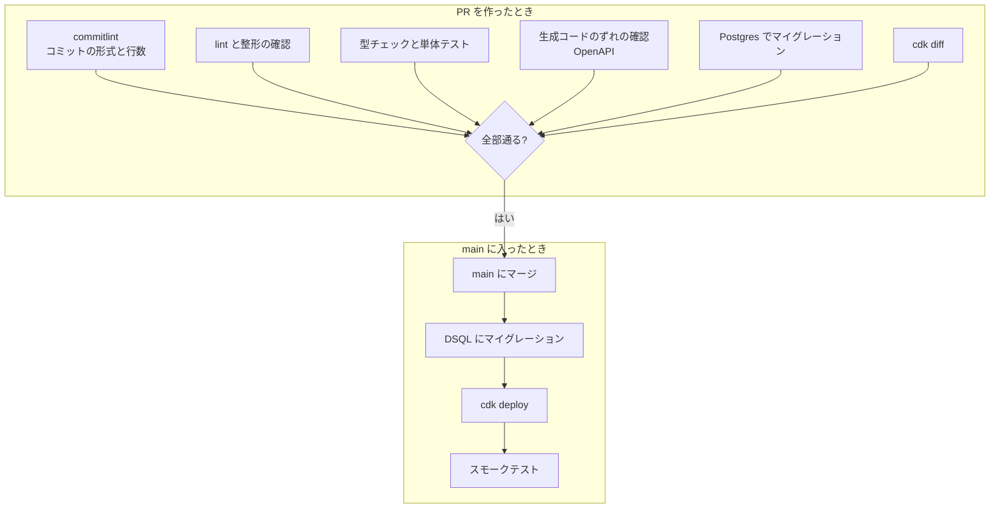

# 0006. CI/CD

- 状態: 承認
- 日付: 2026-10-14

## 背景

- デプロイするものが2つある（Next.js、Go の API）。どちらも OpenAPI の契約に依存している
- DB のマイグレーションには、Better Auth のテーブルと Go のテーブルの両方がある
- プロダクトの特性に合った CI/CD を作る（3-A-2）
- 開発者は1人。費用と時間を抑えたい

## 選択肢

### 環境の数

#### A. 本番だけ

- 良い点: 費用と手間が最小
- 悪い点: 本番で初めて動く変更がある。スモークテストで補う

#### B. 本番＋ステージング

- 良い点: 本番の前に同じ構成で確かめられる
- 悪い点: 費用と管理が倍になる。DSQL などの無料枠も分け合う

#### C. PR ごとのプレビュー環境

- 良い点: PR ごとに動く画面を確かめられる
- 悪い点: 作成と削除の仕組みが要る。1人の開発には大きすぎる

### AWS への認証

#### A. GitHub Actions の OIDC

- 良い点: 長く使える鍵を GitHub に置かない
- 悪い点: IAM ロールと信頼関係の設定が要る

#### B. アクセスキーを GitHub の Secrets に置く

- 悪い点: 漏れたときの被害が大きい。定期的に鍵を替える必要がある

### デプロイの単位

#### A. CDK で全部を一度にデプロイする

- 良い点: インフラとアプリの組み合わせが常に揃う。変わっていないイメージは、ハッシュが同じなので CDK が飛ばす
- 悪い点: 1回のデプロイが少し長くなる

#### B. アプリごとに別のパイプラインにする

- 良い点: 片方だけを素早くデプロイできる
- 悪い点: どの組み合わせが本番にあるのか追いにくい

## 決定

- 環境: A（本番だけ）
- AWS への認証: A（OIDC）
- デプロイの単位: A（CDK で一度に）
- マージ: 「Rebase and merge」だけ（[CONTRIBUTING.md](../../CONTRIBUTING.md)）

守るルール:

- API とテーブルの変更は「先に足して、あとで消す」順にする。マイグレーションをアプリより先に流すので、古いアプリが新しいテーブルでも動くようにする
- OpenAPI から生成したコードは、生成し直して差分がないことを CI で確かめる
- マイグレーションは `db/migrations/` の1か所にまとめる
- 問題が起きたら、前のコミットのイメージを再デプロイして戻す

## 結果

### 良くなること

- PR の時点で、コミットの形式からインフラの差分まで確かめられる
- 長く使える鍵を GitHub に置かない

### 悪くなること・リスク

- ステージングがないので、本番で初めて分かる問題がある。スモークテストで早く気づけるようにする
- マイグレーションは戻せないことがある。「先に足して、あとで消す」で、戻す必要を減らす
